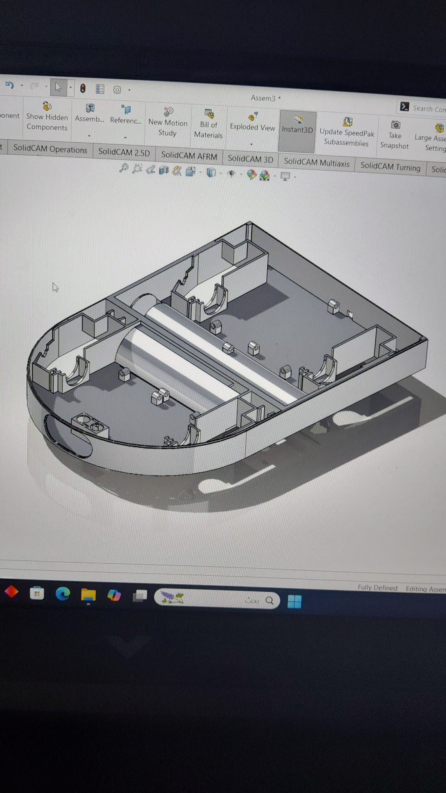

# Solar Panel Cleaning Robot

An Arduino/ESP32-based prototype for cleaning solar panels with a mobile robot. The project combines four-wheel drive, a water pump, a rotating broom, edge/obstacle sensing, an LCD status display, and optional remote control experiments.

## Project overview

The main cleaning firmware is in [`cleaning_may31a`](cleaning_may31a/). It is designed for an ESP32-S3 and uses:

- Four motors driven through motor-driver hardware
- A water pump and cleaning broom controlled through relays
- Front and rear ultrasonic sensors for distance feedback
- Left and right IR sensors for panel-edge safety
- An MPU6050 motion sensor
- A 16x2 I2C LCD
- A physical on/off switch
- Arduino IoT Cloud properties for angle, speed, battery charge, and start/stop control

The robot follows a simple cleaning state machine: forward cleaning, timed turning, backward cleaning, and timed turning in the opposite direction. The side IR sensors are used to react when the robot approaches an edge.

## Design

### System block diagram

### 3D concept

## Hardware

The exact wiring is defined in the constants at the top of [`cleaning_may31a.ino`](cleaning_may31a/cleaning_may31a.ino). The prototype uses:

- ESP32-S3 development board
- Four DC motors and motor drivers
- Water pump and relay module
- Rotating brush/broom and relay module
- Two ultrasonic distance sensors
- Two IR sensors
- MPU6050 accelerometer/gyroscope
- 16x2 I2C LCD
- Physical power switch
- Battery and suitable regulated power supplies

> **Safety:** Test with the wheels raised first. Keep water away from electronics, verify relay polarity, and add an emergency power disconnect before operating the robot on a panel.

## Software setup

1. Install the Arduino IDE and the ESP32 board support package.
2. Install the libraries used by the main sketch:
   - Adafruit MPU6050
   - Adafruit Unified Sensor
   - LiquidCrystal I2C
   - ArduinoIoTCloud
   - Arduino_ConnectionHandler
3. Open `cleaning_may31a/cleaning_may31a.ino`.
4. Select the matching ESP32-S3 board and serial port.
5. Configure the Arduino IoT Cloud device and connection handler. The generated `thingProperties.h` currently contains a placeholder error until a device is associated.
6. Confirm the pin assignments, LCD address, relay active level, and sensor logic match the hardware.
7. Upload the sketch and monitor the serial output at 9600 baud.

The code includes adjustable constants for cleaning distance, default speed, turn duration, and sensor/LCD update intervals.

## Repository structure

| Directory/file | Description |
| --- | --- |
| `cleaning_may31a/` | Main autonomous cleaning sketch and Arduino IoT Cloud properties |
| `ESP32C3WithJoyStick/` | ESP32-C3 joystick sender using ESP-NOW |
| `ESP32S3RecivingJoy/` | ESP32-S3 receiver experiment for joystick control |
| `initial_code/` | Earlier version of the cleaning firmware |
| `images/` | Project photos, concept drawings, block diagram, and reference document |
| Other sketch folders | Focused tests for motors, LCD, ultrasonic, temperature, rain, IR, and tilt sensors |

## Remote-control experiments

The joystick sketches provide a separate ESP-NOW control path:

- `ESP32C3WithJoyStick` reads a two-axis joystick and mixes it into left/right motor speeds.
- `ESP32S3RecivingJoy` receives the control data on the robot-side ESP32-S3.

These sketches are experimental and should be tested independently from the autonomous cleaning firmware.

## Contributing

Create a focused branch, test hardware changes safely, and document any wiring or pin-assignment changes in the relevant sketch before opening a pull request.

## License

No project license has been specified yet. Add a license file before distributing or reusing the project outside its intended development context.
